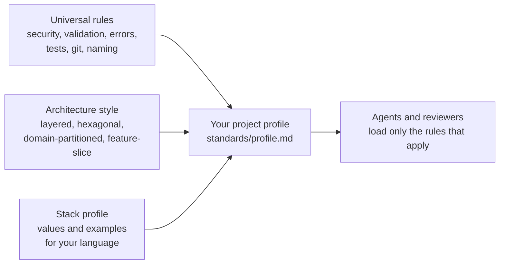

# Kantanda

**One set of engineering standards for many projects, written for people and AI agents.**

Rules are plain Markdown. Each project keeps its own values and exceptions in a short profile. Checks that a tool can run are shipped as ESLint and Semgrep configs.

| | |
|---|---|
| **107 rules** | 39 T1 · 43 T2 · 25 T3 |
| **5 areas** | common · frontend · backend · architecture · guide (+ 2 optional modules) |
| **Rule format** | Markdown, one block per rule, with examples of wrong and right code |
| **Automatic checks** | TypeScript / JavaScript only (ESLint, Semgrep) |

---

## Contents

[What it covers](#what-it-covers) · [What it does not cover](#what-it-does-not-cover) · [How it fits together](#how-it-fits-together) · [Folder map](#folder-map) · [Quick start](#quick-start) · [Core ideas](#core-ideas) · [Customizing](#customizing) · [Status](#status) · [Contributing](#contributing)

---

## What it covers

| Area | Rules | Topics | Folder |
|---|---:|---|---|
| **Common** | 17 | Naming, function size, git and CI gates, dependencies, testing strategy, code review, incident log | [`rules/common`](rules/common) |
| **Frontend** | 31 | UI and accessibility, TypeScript, structure and state, rendering untrusted content, end-to-end tests | [`rules/frontend`](rules/frontend) |
| **Backend** | 28 | HTTP API, validation, errors, database access control, authentication, uploads, SSRF, rate limiting, backend tests | [`rules/backend`](rules/backend) |
| **Architecture** | 13 | Architecture styles, module boundaries, anti-corruption layers, ADRs, domain-driven design | [`rules/architecture`](rules/architecture) |
| **Guide** | 7 | Writing READMEs, technical guides and user documentation | [`rules/guide`](rules/guide) |
| **Optional modules** | 11 | `rag-pgvector` (RAG, embeddings, vector search), `python-ml` (loading ML models safely) | [`rules/backend`](rules/backend) |

Besides rules there are **5 decision frameworks** (choose one option among several), **5 resolved conflicts** between two correct principles, and a log of real incidents. The full list of all 107 rules is in [`rules/README.md`](rules/README.md).

## What it does not cover

Say this up front so nobody assumes more than exists.

| Not covered | Detail |
|---|---|
| **Languages other than TypeScript / JavaScript** | No Rust, Go, Java, Kotlin, Swift or C# rules. Python appears only in the optional `python-ml` module (2 rules). Examples and checks assume Node, Express, Prisma and Next.js. |
| **Mobile apps** | No Android, iOS, Flutter or React Native rules |
| **Infrastructure and deployment** | No dedicated rules for Docker, Kubernetes or infrastructure as code |
| **Other API styles** | No GraphQL or gRPC rules |
| **Internationalization** | No rules |
| **Style packs** | Architecture rules are scoped to a style, but there is no ready-made folder layout plus check per style yet |

> [!NOTE]
> Many security, API and git rules are language-neutral in intent. What is missing for other stacks is examples and automatic checks, not the principles.

## How it fits together



Universal rules hold under every architecture. Architecture rules do not, because styles exclude each other, so each one declares which style it applies to (`applies_to`). Your profile declares the style per package.

> [!IMPORTANT]
> The stack layer is only started. Style-specific folder layouts and per-language checks are not built yet (see [Status](#status)).

## Folder map

```
kantanda/
├── README.md        this file
├── AGENTS.md        entry point for AI agents: which file for which task
├── LICENSE
│
├── rules/           the standards. Start at rules/README.md
├── setup/           files to copy into your project
├── tooling/         ESLint and Semgrep checks for T1 rules
└── maintainers/     audit and build history. Not needed to use Kantanda
```

## Quick start

| Step | Do this |
|:---:|---|
| **1** | Add Kantanda to your project at `standards/kantanda/` (git submodule or a copy). |
| **2** | Copy `setup/profile-template.md` to `standards/profile.md`. Fill in the stack, the architecture style per package, the `{{...}}` parameters, and any overrides. |
| **3** | Copy `setup/AGENTS.root.template.md` to your repo root as `AGENTS.md`. Copy `AGENTS.frontend.template.md` and `AGENTS.backend.template.md` into `frontend/` and `backend/` as `AGENTS.md`. Replace `[Project Name]`. |
| **4** | Turn on the checks: import `tooling/eslint.config.mjs` into your ESLint config and run `tooling/semgrep.yml` with Semgrep. Each file's header shows how. |

Your project then looks like this:

```
my-project/
├── AGENTS.md                root map
├── frontend/AGENTS.md
├── backend/AGENTS.md
└── standards/               this folder is in YOUR project, not in Kantanda
    ├── kantanda/            a copy of this repository
    ├── profile.md           your configuration
    └── adr/                 your architecture decision records
```

## Core ideas

### Rule IDs

Format: `[DOMAIN]-[CATEGORY]-[NUMBER]`, for example `BE-DB-001` (backend, database) or `SEC-AUTH-003`. The prefix tells you which file holds the rule.

### Three enforcement tiers

| Tier | Meaning | Effect |
|:---:|---|---|
| **T1** | A tool in `tooling/` can catch it | Can block a commit |
| **T2** | Tools catch part of it; needs context | Suggestion only |
| **T3** | Not checkable by tools | Never blocks |

A rule is T1 only if a tool enforces it. Today **19 of 39 T1 rules** have a check in `tooling/`; the rest rely on tools outside Kantanda or are not enforced yet.

### Priority when rules conflict

1. **Narrow beats broad:** file conventions, then project profile, then optional modules, then Kantanda.
2. **Within the same scope:** security and data integrity, then correctness, then maintainability, then measured performance.

Some rules can never be overridden by a profile. They are the Non-Negotiable list in [`AGENTS.md`](AGENTS.md).

## Customizing

| I want to... | Do this |
|---|---|
| **Add a rule only my project needs** | Add it to the profile under Extensions, with your own ID prefix (for example `VX-TEST-001`) and a tier. |
| **Not follow a Kantanda rule** | Add a row to the profile's Overrides table: rule ID, what changed, why, an expiry date and who approved it. After the expiry date the override stops counting. Non-Negotiable rules cannot be overridden. |
| **Use RAG or ML rules** | Enable `rag-pgvector` or `python-ml` in the profile's Modules table. Agents read those files only when enabled. |
| **Choose an architecture style** | Declare it per package in the profile's Architecture section. Record the choice as an ADR. See [`rules/architecture/styles.md`](rules/architecture/styles.md). |

## Status

| Item | State |
|---|---|
| Rules and tiers | 107 rules in place |
| `applies_to` on architecture rules | Done (15 rules) |
| T1 rules with a check in `tooling/` | 19 of 39 |
| ESLint and Semgrep checks | TypeScript and JavaScript only |
| Style packs (layout and check per style and stack) | Not built |
| Rust, Python, Java checks | Not built |
| `maintainers/legacy/` | Old XML compiler and profiles. They target a layout that no longer exists and do not run. |

## Contributing

Open an issue or pull request. A new rule needs: an ID, a tier, an `applies_to` value if it concerns architecture, a source or evidence note in [`maintainers/evidence.md`](maintainers/evidence.md), and, for T1, the tool that enforces it. Removed rules are recorded in [`maintainers/pruned.md`](maintainers/pruned.md).

## License

MIT License. You may use, modify and distribute Kantanda for commercial or personal purposes, provided you include a copy of the license.
